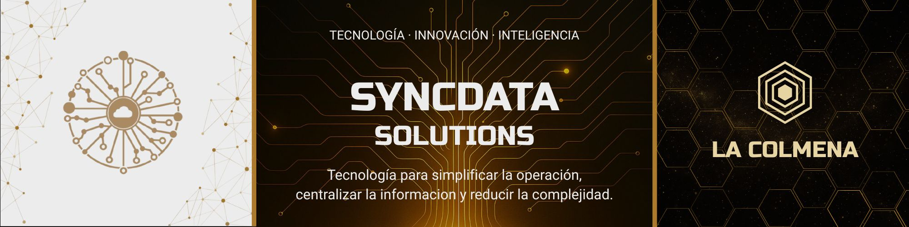
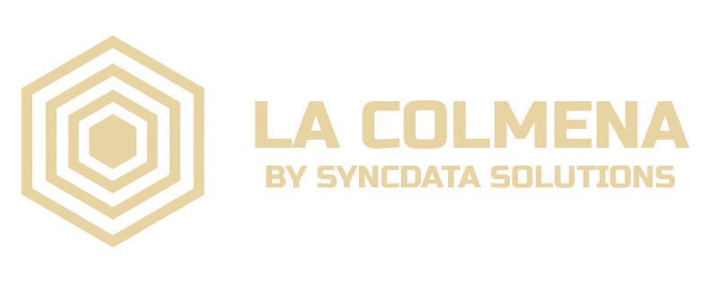

  

#

  <strong>Tecnología para simplificar la operación, centralizar la información y reducir la complejidad.</strong>

  <a href="https://www.syncdatasolutionsaj.com/">Sitio web</a>
  ·
  <a href="https://www.syncdatasolutionsaj.com/la-colmena">La Colmena</a>

---

## Quiénes somos

SyncData Solutions AJ es una empresa de tecnología dedicada al desarrollo de soluciones digitales, sistemas empresariales, automatización e inteligencia artificial.

Diseñamos tecnología orientada a necesidades reales, combinando arquitectura, experiencia, automatización e inteligencia para construir sistemas útiles, escalables y sostenibles.

---

## Qué hacemos

Diseñamos herramientas orientadas a necesidades reales de empresas y organizaciones:

- Centralización de información
- Automatización de procesos
- Integración de sistemas
- Infraestructura tecnológica
- Inteligencia artificial
- Herramientas para la toma de decisiones

Nuestro enfoque parte del problema y no de la tecnología.

---

  

**La Colmena** es el ecosistema tecnológico principal de SyncData Solutions AJ.

Dentro de este entorno desarrollamos, probamos y perfeccionamos nuevas soluciones a partir de necesidades reales.

Los productos se utilizan inicialmente dentro de nuestro propio ecosistema para validar su funcionamiento, utilidad y viabilidad antes de evaluar su lanzamiento como soluciones comerciales para empresas o para el público general.

### Nuestro proceso

**Necesidad → Diseño → Desarrollo → Prueba → Validación → Producto**

Este enfoque nos permite construir tecnología basada en experiencia real y evolucionarla antes de llevarla a nuevos usuarios.

---

## Inteligencia artificial

La inteligencia artificial forma parte de la arquitectura de nuestro ecosistema.

La utilizamos para desarrollar capacidades de:

- Análisis de información
- Asistencia contextual
- Toma de decisiones asistida

La IA se integra como una capacidad del sistema, no como un elemento aislado.

---

## Tecnología y seguridad

Nuestros sistemas se diseñan considerando desde el inicio aspectos como:

- Seguridad
- Control de acceso
- Separación lógica de información
- Arquitectura multi-tenant
- Escalabilidad
- Trazabilidad
- Integridad de los datos

La seguridad y la arquitectura forman parte del diseño desde las primeras etapas del desarrollo.

---

## Nuestra filosofía

No desarrollamos tecnología simplemente por tendencia, primero comprendemos el problema, diseñamos la arquitectura y validamos la solución.

Buscamos crear sistemas útiles, escalables y sostenibles que reduzcan la complejidad tecnológica, la burocracia y permitan a las organizaciones trabajar con mayor claridad y control.

1. Primero entendemos.  
2. Luego diseñamos.  
3. Después construimos.  
4. Finalmente validamos.

---

## Visión

Construir una empresa global de innovación tecnológica, infraestructura digital e inteligencia artificial, desarrollando soluciones capaces de conectar personas, procesos e información de manera eficiente.

Nuestra visión está orientada al desarrollo de tecnología propia, ecosistemas digitales escalables y soluciones capaces de evolucionar junto con las organizaciones que las utilizan.

---

## Innovación y desarrollo

La innovación dentro de SyncData Solutions AJ se construye mediante un proceso continuo de investigación, desarrollo y validación.

Las ideas pueden comenzar como necesidades internas, prototipos o experimentos tecnológicos y evolucionar progresivamente hasta convertirse en soluciones maduras.

**Explorar → Diseñar → Construir → Probar → Aprender → Evolucionar**

---

#

  

  <strong>Bucaramanga, Colombia</strong>  

  © 2024–2026 SyncData Solutions AJ

